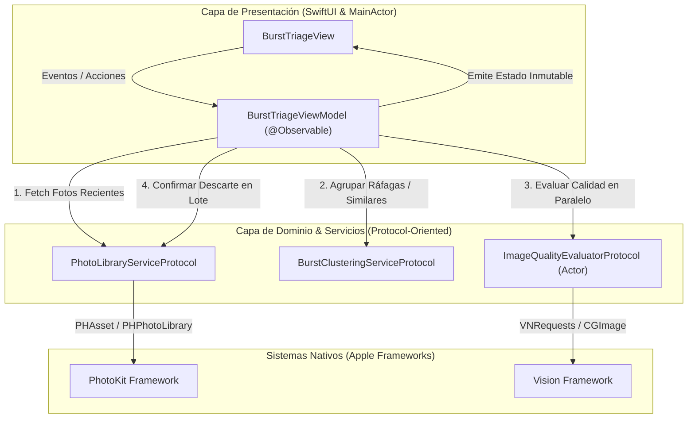

# Technical Architecture Design: Curación y Triaje de Ráfagas (`burst-quality-triage`)

## 1. Architectural Context & Strategy

### Ubicación del Código y Organización
El diseño implementa el patrón **Feature-First** definido en `agents.md`, ubicando los componentes en:
* **`Cull/Features/BurstTriage/`**: Vistas SwiftUI, ViewModels `@Observable` y entidades de estado local del feature.
* **`Cull/Services/PhotoLibrary/`**: Protocolos y adaptadores para la interacción con la biblioteca nativa (PhotoKit).
* **`Cull/Services/ImageQuality/`**: Actor aislado para el análisis visual con Vision Framework y cálculo de calidad.
* **`Cull/Services/BurstClustering/`**: Motor determinista de agrupación temporal y por ráfaga.

### Principios y Pilares Aplicados (`agents.md`)
* **P1 Security & P3 Efficiency (Zero-Cloud / Low Footprint):** El análisis de imágenes se realiza 100% en el dispositivo utilizando un `actor` (`ImageQualityEvaluator`) con procesamiento concurrente en `TaskGroup`, analizando miniaturas downsampleadas para cumplir con el límite estricto de memoria RAM ($\le 120$ MB sobre baseline, `NFR-3`) y latencia $\le 1.5$ s (`NFR-2`).
* **P4 Resilience (Design for Failure):** Errores tipados mediante `AppError`. Si una imagen puntual está dañada, el motor la aísla y continúa procesando el lote (`NFR-5`). Si el usuario cancela el diálogo nativo del sistema operativo, el estado del lote permanece intacto sin corrupción (`EC-6`).
* **P7 Quality & SOLID / SoC:** Separación estricta entre capa de presentación (SwiftUI declarativo), orquestación de estado de UI (`BurstTriageViewModel` en `@MainActor`), y servicios de bajo nivel protegidos por protocolos para inyección y testing determinista.

---

## 2. Component Boundaries & Unidirectional Flow



### Responsabilidades por Capa:
1. **`BurstTriageView`**: Renderiza la lista de grupos, comparativas antes/después, tomas recomendadas y resumen de espacio recuperable. No contiene lógica de negocio ni cálculo de métricas.
2. **`BurstTriageViewModel` (`@MainActor`)**: Orquesta el flujo de usuario, administra la selección de *keepers* múltiples, acciones rápidas ("Eliminar todo" / "Mantener todo") y transforma entidades en estado presentable.
3. **`BurstClusteringService`**: Lógica pura de agrupación que detecta secuencias temporales ($\le 5.0$ s) e identificadores de ráfaga nativa.
4. **`ImageQualityEvaluator` (`actor`)**: Ejecuta el pipeline de Vision (nitidez laplaciana/gradiente, detección facial y apertura de ojos). Al ser un `actor`, garantiza aislamiento de hilos y ejecución fuera del hilo principal.
5. **`PhotoLibraryService`**: Abstracción sobre `PhotoKit` para lectura de metadatos/imágenes y solicitud de eliminación en la papelera del sistema.

---

## 3. Interface Contracts & Data Models

### Modelos de Dominio (`Sendable` e Inmutables)

```swift
/// Representación desacoplada de una fotografía de la biblioteca.
public struct PhotoAsset: Identifiable, Sendable, Equatable, Hashable {
    public let id: String
    public let creationDate: Date
    public let pixelWidth: Int
    public let pixelHeight: Int
    public let byteSize: Int64
    public let isFavorite: Bool
    public let burstIdentifier: String?
    public let representsBurst: Bool

    public init(
        id: String,
        creationDate: Date,
        pixelWidth: Int,
        pixelHeight: Int,
        byteSize: Int64,
        isFavorite: Bool,
        burstIdentifier: String? = nil,
        representsBurst: Bool = false
    ) {
        self.id = id
        self.creationDate = creationDate
        self.pixelWidth = pixelWidth
        self.pixelHeight = pixelHeight
        self.byteSize = byteSize
        self.isFavorite = isFavorite
        self.burstIdentifier = burstIdentifier
        self.representsBurst = representsBurst
    }
}

/// Evaluación objetiva de calidad para una fotografía.
public struct QualityAssessment: Sendable, Equatable {
    public let sharpnessScore: Float       // 0.0 - 1.0 (FR-2)
    public let exposureScore: Float        // 0.0 - 1.0
    public let faceAssessment: FaceAssessment? // nil si no hay rostros (FR-3, EC-5)
    public let compositeScore: Float       // Ponderado final 0.0 - 1.0 (FR-4)

    public init(
        sharpnessScore: Float,
        exposureScore: Float,
        faceAssessment: FaceAssessment? = nil,
        compositeScore: Float
    ) {
        self.sharpnessScore = sharpnessScore
        self.exposureScore = exposureScore
        self.faceAssessment = faceAssessment
        self.compositeScore = compositeScore
    }
}

public struct FaceAssessment: Sendable, Equatable {
    public let faceCount: Int
    public let allEyesOpen: Bool
    public let openEyesConfidence: Float

    public init(faceCount: Int, allEyesOpen: Bool, openEyesConfidence: Float) {
        self.faceCount = faceCount
        self.allEyesOpen = allEyesOpen
        self.openEyesConfidence = openEyesConfidence
    }
}

/// Candidata a triaje dentro de un grupo con su evaluación asociada.
public struct PhotoCandidate: Identifiable, Sendable, Equatable {
    public var id: String { asset.id }
    public let asset: PhotoAsset
    public let assessment: QualityAssessment?

    public init(asset: PhotoAsset, assessment: QualityAssessment? = nil) {
        self.asset = asset
        self.assessment = assessment
    }
}

/// Estado de resolución de un grupo de triaje.
public enum ClusterReviewStatus: Sendable, Equatable {
    case pending
    case reviewedKept
    case reviewedDiscarded
}

/// Agrupación de fotos similares o ráfagas evaluadas.
public struct BurstCluster: Identifiable, Sendable, Equatable {
    public let id: UUID
    public let items: [PhotoCandidate]
    public var keeperIds: Set<String>     // Permite múltiples keepers (FR-9)
    public var discardIds: Set<String>    // Candidatas actuales a descarte (FR-6)
    public var status: ClusterReviewStatus

    /// Espacio en bytes recuperable al purgar las fotos marcadas en discardIds (FR-8).
    public var recoverableByteSize: Int64 {
        items
            .filter { discardIds.contains($0.id) }
            .reduce(0) { $0 + $1.asset.byteSize }
    }

    public var isAllDiscarded: Bool {
        discardIds.count == items.count
    }

    public var isAllKept: Bool {
        discardIds.isEmpty
    }
}
```

### Contratos Públicos (Protocolos de Servicio)

```swift
/// Contrato para interactuar con la biblioteca de fotos sin acoplamiento a PhotoKit.
public protocol PhotoLibraryServiceProtocol: Sendable {
    func requestAuthorization() async -> Bool
    func fetchRecentAssets(limit: Int) async throws -> [PhotoAsset]
    func fetchImageData(for assetId: String, targetSize: CGSize) async throws -> Data
    func deleteAssets(withIDs ids: [String]) async throws -> Bool
}

/// Contrato para agrupar fotografías en lotes de ráfaga o proximidad temporal (FR-1).
public protocol BurstClusteringServiceProtocol: Sendable {
    func clusterize(assets: [PhotoAsset], timeThresholdSeconds: TimeInterval) -> [BurstCluster]
}

/// Contrato para evaluar la calidad visual de forma asíncrona y segura (FR-2, FR-3, FR-4).
public protocol ImageQualityEvaluatorProtocol: Sendable {
    func evaluateQuality(for imageData: Data) async throws -> QualityAssessment
}
```

### Estado del ViewModel (`BurstTriageViewModel`)

```swift
public enum BurstTriageViewState: Equatable, Sendable {
    case idle
    case requestingPermission
    case analyzing(progress: Float, message: String)
    case loaded(clusters: [BurstCluster])
    case processingDiscard
    case empty(reason: String)
    case error(AppError)
}
```

---

## 4. Error Handling & Resilience Strategy

### Taxonomía de Errores y Degradación
Siguiendo **P4 (Resilience)**, el módulo define y consume casos de `AppError`:

| Condición de Error | Tipo de `AppError` | Manejo y Experiencia de Usuario |
| :--- | :--- | :--- |
| **Permiso de fotos denegado / limitado** | `.unauthorized` | Muestra estado explicativo en pantalla invitando al usuario a habilitar acceso en Ajustes. |
| **Imagen corrupta o no decodificable (`NFR-5`)** | `.invalidInput(reason:)` | El servicio la omite (`try?`) y califica el activo con puntaje neutro sin bloquear el análisis del resto del lote. |
| **Cancelación del diálogo del sistema (`EC-6`)** | N/A (Resultado booleano `false`) | No lanza error. El ViewModel mantiene el estado del grupo intacto y no muta los datos. |
| **Error en tiempo de ejecución de Vision** | `.operationFailed(description:)` | Degradación elegante: se asume calidad base sin reconocimiento facial y se notifica al logger (`P5`). |

---

## 5. Testing Strategy (Mapping a Criterios de Aceptación)

| Criterio de Aceptación (`spec.md`) | Nivel de Prueba | Test Double / Mock | Resultado Observable |
| :--- | :--- | :--- | :--- |
| **Scenario 1 (Mejor toma nítida)** | Unit (`XCTest`) | `MockImageQualityEvaluator` | `keeperIds` contiene únicamente la foto #2; las restantes están en `discardIds`. `recoverableByteSize` coincide. |
| **Scenario 2 (Multi-Keeper)** | Unit (`XCTest`) | `BurstTriageViewModel` aislado | Al invocar `toggleKeeper`, `keeperIds` pasa a tener 2 elementos y `discardIds` se reduce en tiempo real. |
| **Scenario 3 (Eliminar Todo)** | Unit (`XCTest`) | `MockPhotoLibraryService` | Al invocar `discardAll`, `discardIds` contiene el 100% de los IDs del lote. Al confirmar, llama a `deleteAssets` con todos los IDs. |
| **Scenario 4 (Mantener Todo)** | Unit (`XCTest`) | `BurstTriageViewModel` | `discardIds` queda vacío (`0` bytes a recuperar) y el estado del cluster pasa a `.reviewedKept`. No se llama a `deleteAssets`. |
| **Scenario 5 (Protección de Favoritas)** | Unit (`XCTest`) | `BurstClusteringService` | La foto con `isFavorite: true` nunca se incluye en `discardIds` en la propuesta inicial. |
| **Scenario 6 (Resolución de Empates)** | Unit (`XCTest`) | `BurstClusteringService` | En empate exacto, el keeper propuesto es la foto con `creationDate` más antiguo. |
| **EC-6 (Cancelación en Diálogo)** | Unit (`XCTest`) | `MockPhotoLibraryService` (`returns false`) | El cluster conserva su estado `.pending` y ningún elemento es removido. |

---

## 6. Architectural Trade-offs & Alternatives

* **Procesamiento de Calidad: `actor` dedicado vs. `Task.detached` sin aislamiento:**
  * *Elegido:* Un `actor ImageQualityEvaluator` dedicado.
  * *Razón:* Garantiza seguridad de concurrencia de Swift 6 (`P7`), evita carreras de datos al invocar múltiples requests de Vision concurrentes y permite aplicar contrapresión sobre el límite de memoria RAM (`NFR-3`).
* **Representación de Selecciones: Índices de Array vs. `Set<String>` de IDs:**
  * *Elegido:* `Set<String>` con los identificadores estables de los activos (`keeperIds`, `discardIds`).
  * *Razón:* Permite consultas en $O(1)$, desacopla el orden visual del estado de decisión y previene errores de índices fuera de rango ante actualizaciones de UI o reordenamientos.
* **Persistencia Prematura vs. Estado en Memoria:**
  * *Elegido:* Estado en memoria orquestado en el ViewModel, delegando la persistencia de cambios a `PHPhotoLibrary`.
  * *Razón:* Cumple con la directriz estricta de `agents.md` (*YAGNI*). La fuente de verdad del carrete es el sistema operativo; guardar bases de datos locales intermedias en esta fase agregaría complejidad y riesgo de desincronización innecesario.
